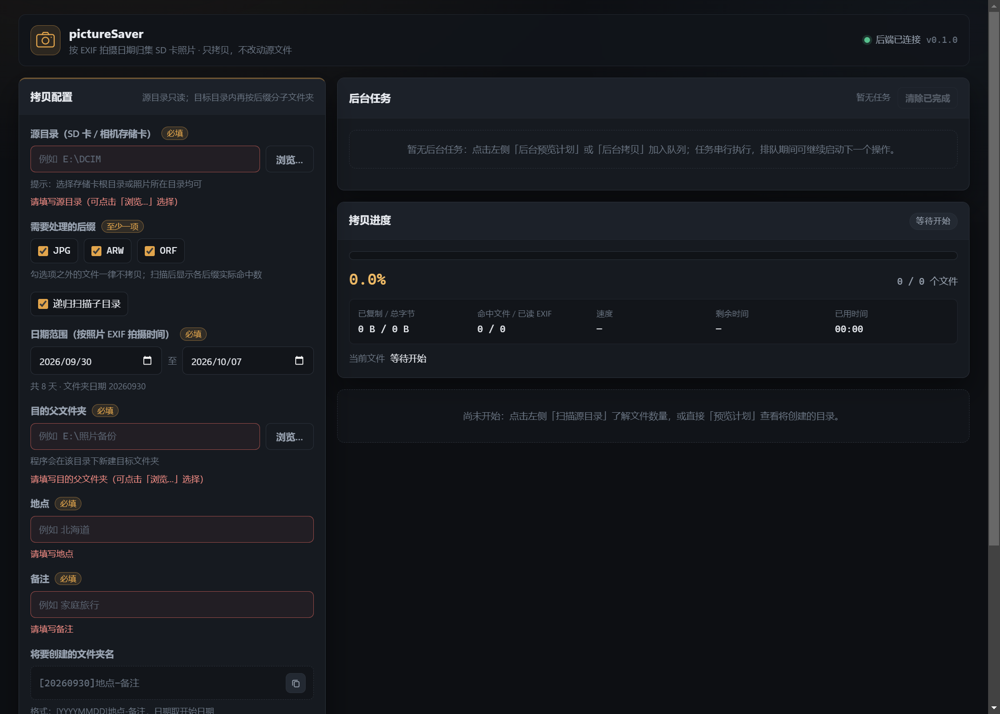
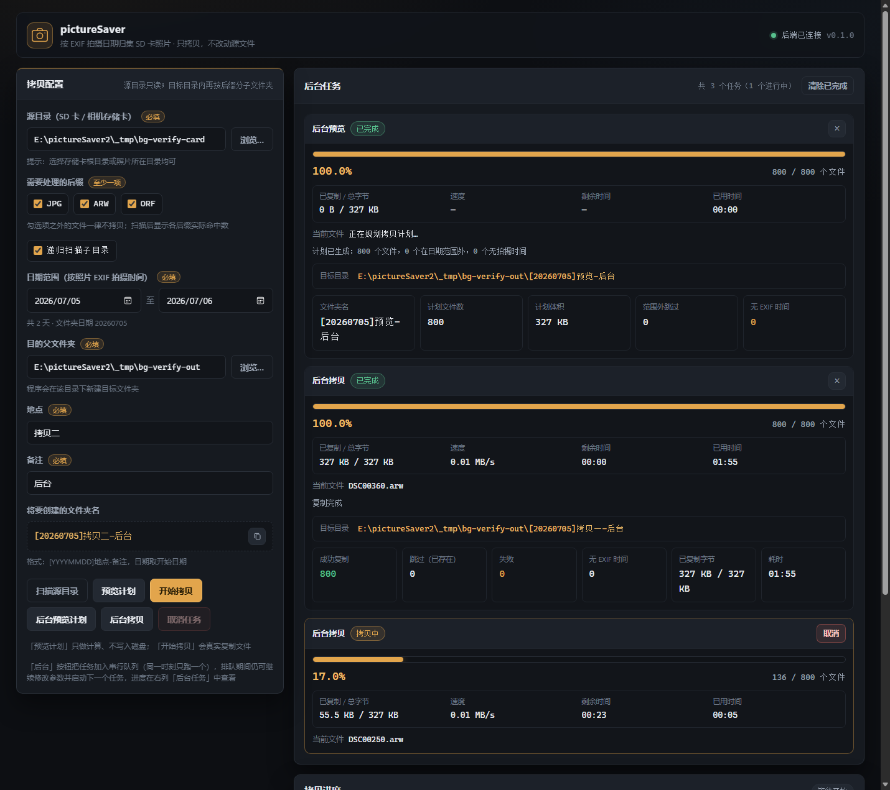
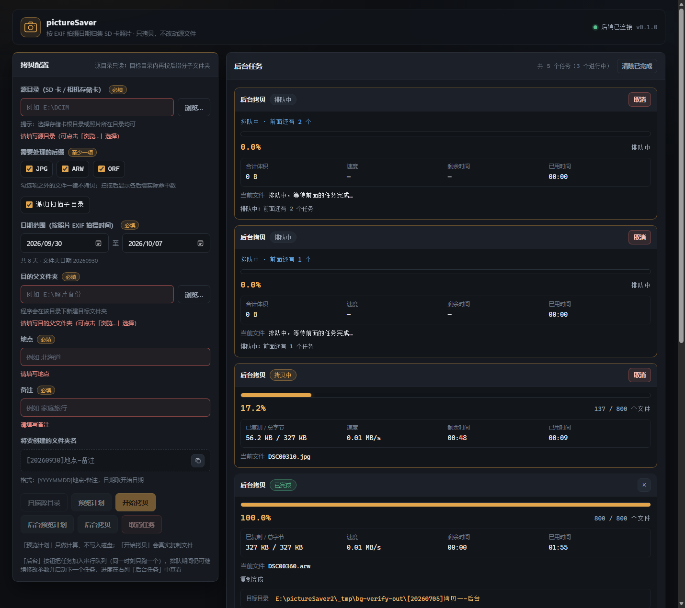

# pictureSaver2 —— SD 卡照片按日期范围拷贝工具

把 SD 卡（相机存储卡）里**指定日期范围内的照片**，按 `jpg + raw` 成对结构拷贝到
`[日期]地点-备注` 目录，并在其内部**按后缀分子文件夹**存放。源文件只读，绝不移动或删除。

- **桌面端**：双击 `pictureSaver2.exe` 打开原生窗口，窗口里就是同一套 Web 界面（QtWebEngine），关闭窗口即退出
- **Web 界面**：选择日期范围 / 源目录 / 后缀 / 目的父目录 / 地点 / 备注，**进度条显示真实进度**（字节级）
- **命令行**：`picsaver scan` / `picsaver copy` / `picsaver web` / `picsaver desktop`，带 tqdm 进度条
- **前后端分离**：`core`（纯业务内核）← `api`（FastAPI）/ `cli` / `desktop`（桌面外壳），三层共用同一套 core 与同一套 Web 界面

桌面窗口的实际样子（QtWebEngine 真实窗口，CDP 抓图）：



界面与产出的实际效果（无头 Edge 真实浏览器实跑截图，608 个文件 / 600 MB 素材）：


后台任务中心（串行队列 + 可关闭）：





---

## 1. 功能

| 需求 | 实现 |
| --- | --- |
| 输入目录（SD 卡） | 递归扫描，自动跳过 `$RECYCLE.BIN`、`System Volume Information`、隐藏目录 |
| jpg + raw 成对 | 同目录同名（忽略大小写与后缀）视为**一张照片**；raw 支持 **arw**（索尼）、**orf**（奥林巴斯），也支持 jpg/jpeg |
| 日期范围 | 拍摄时间来自 EXIF，**范围含首尾两天**；日期范围第一天决定目标目录名的日期 |
| 目标目录 | `父文件夹\[YYYYMMDD]地点-备注`，例如 `E:\照片备份\[20260704]北海道-家庭旅行` |
| 按后缀分文件夹 | 目标目录内 `JPG\`、`ARW\`、`ORF\` … |
| 只拷勾选后缀 | 严格按勾选后缀执行；同名配对只用于**统一时间判定** |
| 无 EXIF 时间 | **跳过**，并在报告 / 界面中逐条列出（不猜测、不静默丢弃） |
| 进度条 | 来自 core 的真实事件：**扫描/预览**显示"已扫描 X / 共 Y 个文件"，**复制**显示字节进度、当前文件、速度、ETA、已用时间 |
| 目录浏览 | 浏览弹窗**只列文件夹**、不对普通文件做 stat：2 万个文件的目录实测从 ~1435 ms 降到 ~15 ms（`scripts/bench_browse.py` 可复现），超出 2000 个子目录时提示"仅显示前 2000 个" |
| 新建文件夹 | 浏览弹窗内可直接新建文件夹（`POST /api/mkdir`），带空名/非法字符/重名/Windows 保留名校验 |
| 任务期锁定 | 扫描 / 预览 / 拷贝进行中，配置区整体锁定（输入框、浏览按钮、后缀、日期、地点、备注都不可改），只保留「取消任务」 |
| 后台任务 | 「后台预览计划」「后台拷贝」在后台排队执行：配置区**不锁定**，可以继续改参数、继续启动下一次操作；每张任务卡显示真实进度，完成后显示结果，点 **×** 关闭即不再显示（刷新后也不回来） |
| 串行队列 | 所有任务（前台 + 后台）走同一条队列，**任一时刻只执行一个**（前台任务插到等待列表最前面）；后续任务显示「排队中 · 前面还有 N 个」 |
| 安全 | 只复制；临时文件 + 改名防止半截文件；同名同大小视为已存在而跳过；重名自动加 `_1` |
| 报告 | 成功 / 已存在跳过 / 失败明细 / 无时间跳过 / 日期范围外 / 重名改名 / 字节数 / 耗时 |
| 桌面端 | QtWebEngine 原生窗口承载**同一套 Web 界面**，可打包为**单文件 exe**；关闭窗口即退出，有任务在跑会二次确认 |

## 2. 环境与安装

- Python **3.10+**（本机验证版本 3.10.11），Windows
- 运行依赖（版本为本机已验证组合）：ExifRead、Pillow、fastapi、uvicorn、sse-starlette、pydantic 1.x、typer、click、tqdm；测试用 pytest
- 桌面端额外需要 **PySide6**（QtWebEngine，本机已装 6.9.0）；打包额外需要 **PyInstaller**（仅构建期）

```powershell
# 中国大陆：必须使用清华镜像
python -m pip install -r requirements.txt -i https://pypi.tuna.tsinghua.edu.cn/simple

# 需要桌面端 / 打包时（PySide6 + PyInstaller）
python -m pip install -r requirements-desktop.txt -i https://pypi.tuna.tsinghua.edu.cn/simple
```

> 仓库根目录的 `pip.conf` 是项目级镜像配置示例。
> 本项目**不需要安装**即可运行（`run_web.cmd` / `run_desktop.cmd` 会自动把 `src` 加入 `PYTHONPATH`）；
> 也可以 `python -m pip install -e . -i https://pypi.tuna.tsinghua.edu.cn/simple` 安装成 `picsaver` 命令。

## 3. 使用：Web 界面（推荐）

```powershell
.\run_web.cmd            # 推荐：默认 http://127.0.0.1:8765/（批处理，不受 PowerShell 执行策略影响）
.\run_web.cmd 9000       # 指定端口

# 也可以用 PowerShell 脚本（若被执行策略拦截，就加 -ExecutionPolicy Bypass）
powershell -NoProfile -ExecutionPolicy Bypass -File .\run_web.ps1 8765
```

浏览器打开后：

1. **源目录**：手动输入，或点【浏览…】逐级选择（只列文件夹，大目录也是秒开；在弹窗里可以直接【新建文件夹】）
2. **需要处理的后缀**：勾选 jpg / arw / orf（扫描后每项旁显示实际命中数量）
3. **日期范围**：开始 / 结束日期（开始日期即目标文件夹名中的日期）
4. **目的父文件夹**：程序会在其下新建 `[YYYYMMDD]地点-备注`
5. **地点 / 备注**：必填，会写进目录名；非法字符会即时提示
6. 先【预览计划】核对将创建的目标目录与文件数，再【开始拷贝】
7. 进度条实时显示进度：扫描/预览阶段是**已扫描 X / 共 Y 个文件**，复制阶段是百分比、字节数、当前文件、速度与剩余时间；可随时【取消任务】

三种操作的关系：`扫描源目录` 只统计；`预览计划` 只计算不写盘；`开始拷贝` 才真正复制文件。
**三种前台操作运行期间，左侧配置区会整体锁定**，结束后自动解锁。

**后台任务**：不想等着看进度时，用【后台预览计划】【后台拷贝】把任务丢到后台任务中心：

- 配置区**不锁定**，可以继续改参数、继续提交下一个任务（全部排队，任一时刻只跑一个，不会互相拖慢磁盘）
- 每张任务卡都有真实进度（扫描阶段「已扫描 X / 共 Y 个文件」，复制阶段百分比 / 字节 / 速度 / ETA / 当前文件）
- 排队中的任务可以直接【取消】（绝不会开始执行）
- 任务结束后卡片显示结果摘要，点卡片右上角 **×** 关闭即不再显示；也可以【清除已完成】批量关闭
- 刷新页面后，排队中 / 运行中的任务会自动恢复显示
- 同一目标目录的第二个**拷贝**任务会被拒绝并提示（避免两个任务写同一批文件）

## 4. 使用：桌面端（双击即用 / 打包 exe）

桌面端是**同一个程序的外壳**：起一个本地服务，再用 QtWebEngine 原生窗口加载**同一套 Web 界面**，
所以功能、界面、进度显示与浏览器模式完全一致，不需要两边分别维护。

```powershell
# 开发/本机运行（需要 PySide6）
.\run_desktop.cmd              # 默认端口 8765，被占用时自动换空闲端口
.\run_desktop.cmd 9000         # 指定首选端口
python -m picsaver desktop     # 等价写法
picsaver desktop --smoke       # 只自检服务与静态资源，不开窗口（打包验证用）
```

**打包成单个 exe**：

```powershell
.\build_desktop.ps1            # 默认 onefile -> dist\pictureSaver2.exe（约 200-300 MB）
.\build_desktop.ps1 -OneDir    # 备选：目录版 dist\pictureSaver2\pictureSaver2.exe（启动更快、杀软误报更少）
```

打包脚本会自动用清华镜像安装 PyInstaller（构建期依赖）。产物在 `dist/`（已在 `.gitignore` 中，不入库）。

**桌面端行为约定**

| 行为 | 说明 |
| --- | --- |
| 关闭窗口 | 直接退出程序，本地服务随之停止 |
| 有任务在跑时关闭 | 先弹确认框（说明已复制的文件会保留、不会留下半截文件），确认后先请求取消再退出 |
| 重复双击 | 只保留一个服务实例；第二次会打开一个指向已有服务的窗口（关闭它不会影响已有服务） |
| 端口占用 | 8765 被占用时自动改用系统分配的空闲端口 |
| 窗口不可用 | 若 QtWebEngine 起不来，自动改用系统默认浏览器打开，并给出日志路径 |
| 日志 | `%LOCALAPPDATA%\pictureSaver2\desktop.log`（窗口模式没有控制台，排错看这里） |
| 自检 | `pictureSaver2.exe --smoke` 会写 `%TEMP%\picsaver2-smoke.json` 并在成功时返回 0 |

## 5. 使用：命令行

```powershell
# 只扫描统计
python -m picsaver scan -s E:\DCIM -x jpg,arw,orf

# 预览（不落盘）
python -m picsaver copy -s E:\DCIM --date-from 2026-07-04 --date-to 2026-07-06 `
    -t "E:\照片备份" -p 北海道 -n 家庭旅行 -x jpg,arw,orf --dry-run

# 真实拷贝（-p / -n 不传时会交互式询问）
python -m picsaver copy -s E:\DCIM --date-from 2026-07-04 --date-to 2026-07-06 `
    -t "E:\照片备份" -p 北海道 -n 家庭旅行 -x jpg,arw

# 启动 Web 界面
python -m picsaver web --host 127.0.0.1 --port 8765
```

未安装包时请先设置 `$env:PYTHONPATH='src'`，或使用 `run_web.ps1`。

## 6. HTTP 接口（前后端分离的契约）

| 方法 | 路径 | 说明 |
| --- | --- | --- |
| GET | `/` | 前端页面（静态资源在 `/static`） |
| GET | `/api/health` | 健康检查 |
| GET | `/api/defaults` | 界面默认值（默认后缀、今天） |
| GET | `/api/browse?path=` | 目录浏览：**只列文件夹**，返回 `path/parent/dirs/truncated/total_dirs/elapsed_ms/error`（省略 path 列盘符） |
| POST | `/api/mkdir` | 新建文件夹：`{parent, name}` → `{path, name, created}` |
| POST | `/api/scan` | 同步扫描统计（脚本用；界面走任务模式以便显示进度） |
| POST | `/api/preview` | 同步生成计划（脚本用） |
| POST | `/api/jobs` | 创建任务：`{config:{...}, mode:"scan"\|"preview"\|"copy", dry_run, background}` → `{job_id, status:"queued"\|"running", mode, queue_position}` |
| GET | `/api/jobs` | 任务列表（最新在前）；`?brief=1` 时不返回 report 正文（界面轮询用） |
| GET | `/api/jobs/{id}` | 任务状态 / 进度 / 报告（含 `queue_position`、`age_seconds`、`has_report`） |
| GET | `/api/jobs/{id}/events` | **SSE 实时进度**（断线时前端自动降级为轮询） |
| POST | `/api/jobs/{id}/cancel` | 取消任务（排队中取消 = 立刻取消且绝不执行；运行中 = 尽快停止，已拷贝文件保留） |
| DELETE | `/api/jobs/{id}` | 关闭（遗忘）已结束的任务；进行中返回 409 |

**串行队列语义**：所有任务共用一条队列，任一时刻只有一个任务真正执行，其余 `status="queued"`
（`progress.phase="queued"`，`progress.message` 形如「排队中：前面还有 2 个任务」）。
`background=true`（界面上的后台按钮）按提交顺序 FIFO；`background=false`（默认，前台按钮）
插到等待列表最前面。同一目标目录的第二个**拷贝**任务返回 **409**
（`{"detail":"已有任务正在处理同一目标目录：…"}`）；任务数达到上限且都在进行中时返回 **429**。

`config` 字段：`source_dir, suffixes[], date_from, date_to, target_parent, place, note, recursive`。
其中 `mode="scan"` 只要求 `source_dir` 与 `suffixes`（日期/地点/备注/目标目录可以是空的），
`preview` / `copy` 则要求字段齐全，否则返回 400 与中文提示。
`mode` 省略时按 `dry_run ? "preview" : "copy"` 处理（兼容旧调用）。
`/api/mkdir` 的所有失败情况（名称为空、含非法字符、首尾空格或点、重名、Windows 保留名、父目录不存在）
统一返回 **400 + 中文字符串 `detail`**，便于界面直接展示。

进度对象（SSE 事件与轮询同构）：

```json
{"phase":"scanning","message":"正在读取拍摄时间：120/500",
 "total_files":500,"done_files":120,"scanned_files":120,"scan_total_files":500,
 "total_bytes":0,"done_bytes":0,"current_file":"E:\\DCIM\\DSC0001.ARW",
 "percent":24.0,"speed_bps":0.0,"eta_seconds":null,"elapsed_seconds":3.1}
```

- `phase`：`queued` → `counting` → `scanning` → `planning` → `copying` → `finished` / `canceled` / `failed`
- 扫描阶段 `percent = scanned_files / scan_total_files`；复制阶段 `percent` 按字节计算
- `queued` 不是终局：`status ∈ {queued, running}` 表示任务还没结束
- 报告按模式区分：`scan` → `{mode, canceled, scan}`；`preview` → `{mode, canceled, plan, scan}`；`copy` → CopyReport 全部字段 + `mode`

## 7. 架构

```
浏览器(前端)  --HTTP/SSE-->  api (FastAPI)  --+
                                              +--> core (纯内核，无界面依赖)
CLI (typer)  ---------------------------------+
桌面端(QtWebEngine 窗口) --HTTP/SSE ----------+   ← 加载的就是同一套前端
```

```
src/picsaver/
├─ core/            # 纯业务内核：不 import 任何 Web / CLI 框架
│  ├─ models.py     #   数据模型与参数校验（CopyConfig / ScanResult / CopyPlan / CopyReport）
│  ├─ exif_time.py  #   拍摄时间：ExifRead -> Pillow -> 内置 TIFF/EXIF 解析
│  ├─ scanner.py    #   扫描、后缀过滤、jpg/raw 配对、无时间文件清单
│  ├─ planner.py    #   日期范围筛选、[YYYYMMDD]地点-备注、后缀子目录、防重名
│  ├─ copier.py     #   分块复制 + 临时文件改名 + 进度事件 + 取消
│  ├─ metrics.py    #   速度 / ETA 估算
│  ├─ events.py     #   进度事件模型
│  └─ service.py    #   门面：scan / preview / run
├─ api/             # FastAPI 后端：参数校验 + 任务编排 + SSE
├─ cli/             # 命令行：scan / copy / web / desktop（tqdm 进度条）
├─ desktop/         # 桌面外壳：单实例锁 + 起服务 + QtWebEngine 窗口 + 退出清理
│  ├─ server.py     #   服务引导（不依赖 Qt，可单测；含端口回退、任务查询/取消）
│  ├─ instance.py   #   单实例锁与 instance.json
│  ├─ window.py     #   Qt 窗口（Qt 只在函数内延迟导入）
│  ├─ smoke.py      #   --smoke 自检（不开窗口，供打包验证）
│  ├─ main.py       #   编排：单实例 → 服务 → 窗口 → 清理
│  └─ icon.ico      #   窗口 / exe 图标（scripts/make_icon.py 生成）
└─ web/             # 原生 HTML/CSS/JS 前端（无构建、无 CDN，离线可用）
```

## 8. 测试与验证

```powershell
$env:PYTHONIOENCODING='utf-8'
python -m pytest -q          # 103 项单元 / 接口 / 端到端 / 桌面用例
```

测试素材全部为**合成文件**（`tests/fixtures.py` 生成带真实 EXIF 结构的 JPG 与 TIFF 系 ARW/ORF），
不依赖任何真实照片。

已完成的实机验证：

1. `pytest` **97 项全绿**（core 扫描/计划/复制、任务模式与扫描进度、串行队列 8 项、API 全部端点、目录浏览与新建文件夹、端到端流程，以及真实 uvicorn + SSE 进度流）
2. 真实 `uvicorn` 服务：**26 项检查**（前台流程）+ **31 项检查**（后台队列：并发峰值 1、前台插队位置 2、同目标 409 中文提示、排队中取消绝不执行、关闭后 404、brief 无 report 正文、排队任务 SSE 首条为 `queued`）全过
3. **无头 Edge 真实浏览器**（`scripts/verify_browser.py` 35 项 + `scripts/verify_background.py` 后台任务中心）：
   两万文件目录浏览 10.8 ms 且只列文件夹、弹窗内新建文件夹、三种任务都有真实进度、
   任务期锁定、后台任务排队（「排队中 · 前面还有 N 个」）、后台运行期间配置区可继续编辑、
   完成后卡片显示 100% 与结果摘要、× 关闭后刷新不复活、「清除已完成」批量关闭、
   **刷新页面自动恢复进行中的任务**（见截图 08），全程无 JS 错误
4. 目录浏览性能基线可复现：`python scripts\bench_browse.py`（20000 文件：旧实现 ~1435 ms → 新实现 ~15 ms）
5. CLI 四种用法（scan / dry-run / 真实拷贝 / web）实跑通过，扫描与复制都有 tqdm 进度条
6. **桌面端**：`pytest` 新增 13 项（端口回退、服务引导与静态资源、健康检查超时、单实例锁、`--smoke` 报告、CLI 注册、Qt 延迟导入约定）；
   源码运行的真实桌面窗口已用 CDP 核对（标题、后端已连接、后台任务中心已渲染、窗口内可直接调接口）并截图；
   打包产物在本环境下的实测结论见下表。

### 打包验证结果（2026-10-11 实测）

| 产物 | 本环境（受限沙箱） | 结论 |
| --- | --- | --- |
| `dist\pictureSaver2\`（onedir） | ✅ **跑通**：`--smoke` 返回 `{"ok": true, "health": true, "index": true, "index_bytes": 20865}`，有无控制台/句柄都一样 | onedir 无父子进程拆分，受限环境也能运行 |
| `dist\pictureSaver2.exe`（onefile） | ❌ 本环境起不来：`_MEI` 解压成功，但引导器与子进程的握手失败（退出码 -1） | **构建正常**，但需在普通会话里运行；受限沙箱用 onedir |
| 桌面窗口（QtWebEngine/Chromium） | ❌ 本环境起不来：`FATAL:named-platform-channel-pipe ... 拒绝访问 (0x5)`（我们的代码与本地服务已正常启动，仅 Chromium 无法建管道） | 需非受限会话；源码运行时的窗口已于 10/7 在不受限会话验证并截图（见上图 09） |
| 桌面日志 `%LOCALAPPDATA%\pictureSaver2\desktop.log` | ⚠️ 受限沙箱**禁止写工作区外路径**（`os.access` 说可写，实际 `FileHandler` 抛 PermissionError） | 普通会话正常；沙箱内排错要靠控制台版的 stdout |

**在普通会话里验证 exe（两条命令）**：

```powershell
Start-Process dist\pictureSaver2.exe -ArgumentList '--smoke','--port','8797' -Wait
Get-Content "$env:TEMP\picsaver2-smoke.json"      # 期望 {"ok": true, ...}

python scripts\verify_desktop.py --launch-exe dist\pictureSaver2.exe --app-port 8797 --cdp-port 9223
```

> 若只想在本机（含受限环境）拿到"能跑起来的打包产物"，用目录版：`.\build_desktop.ps1 -OneDir`。

### 复现浏览器验证

```powershell
# 1) 启动后端
.\run_web.cmd 8791

# 2) 启动无头 Edge（另开一个终端）
& 'C:\Program Files (x86)\Microsoft\Edge\Application\msedge.exe' `
  --headless=new --disable-gpu --no-first-run --remote-debugging-port=9222 `
  --user-data-dir="$env:TEMP\picsaver-edge" --window-size=1460,1240 http://127.0.0.1:8791/

# 3) 跑验证（会自动生成 600 MB 演示素材、交互、对比磁盘产物并截图）
$env:PYTHONIOENCODING='utf-8'
python scripts\verify_browser.py --base-url http://127.0.0.1:8791

# 4) 后台任务中心验证（排队 / 进度 / × 关闭 / 清除已完成 / 刷新恢复）
python scripts\verify_background.py --base-url http://127.0.0.1:8791
```

> 两个脚本都要求后端是**刚启动的干净实例**（任务列表为空），否则恢复出来的历史任务会干扰断言。

### 复现桌面端验证

```powershell
# 1) 源码运行的窗口（自己拉起窗口 + 用 CDP 检查页面并截图）
$env:PYTHONIOENCODING='utf-8'
python scripts\verify_desktop.py --launch-module --app-port 8796 --cdp-port 9222

# 2) 打包后的 exe：先自检（不开窗口），再验证真实窗口
.\build_desktop.ps1                                  # 产出 dist\pictureSaver2.exe
Start-Process dist\pictureSaver2.exe -ArgumentList '--smoke','--port','8797' -Wait
Get-Content "$env:TEMP\picsaver2-smoke.json"         # {"ok": true, ...}
python scripts\verify_desktop.py --launch-exe dist\pictureSaver2.exe --app-port 8797 --cdp-port 9223
```

> 桌面窗口（QtWebEngine/Chromium）**必须在非受限会话里运行**：受限沙箱会拦截 Chromium 的命名管道
> （实测报 `named-platform-channel-pipe ... 拒绝访问 0x5` 并直接崩溃）。`--smoke` 不开窗口，不受影响。

## 9. 常见问题

- **无 EXIF 时间的照片怎么办？** 会被跳过并列出。想一并归档时，可先用相机/软件写入拍摄时间，或单独手动处理这些文件。
- **同名文件来自不同子目录？** 目标内自动加 `_1`、`_2`，并在报告中记为"重名改名"。
- **能重复运行吗？** 可以。已存在且大小相同的文件会记为"已存在跳过"，不会重复写入。
- **会修改 SD 卡吗？** 不会。全程只读源目录，只做复制。
- **速度显示 `—`？** 复制刚开始不足 0.2 秒时无法估算速度与 ETA，稍后即会出现。
- **后台任务和前台操作会同时跑吗？** 不会。所有任务（前台 + 后台）走同一条串行队列，任一时刻只执行一个；
  前台任务会插到等待队列最前面，其余显示「排队中 · 前面还有 N 个」。
- **点任务卡上的 × 会删掉已复制的文件吗？** 不会，× 只是把这个任务从列表里移除（前后端一起遗忘），磁盘上的照片保持原样。
- **刷新页面后后台任务还在吗？** 后端进程内保留任务，页面会自动恢复「排队中 / 运行中」的任务与最近 10 分钟完成的记录；
  已经被 × 关闭的任务不会恢复。重启后端进程则任务列表清空（已复制的文件不受影响）。
- **点【浏览…】时看着卡？** 浏览接口只列文件夹、不读文件属性；若某个目录子文件夹超过 2000 个，会提示"仅显示前 2000 个"（可用上方路径框直接输入深层路径继续进入）。
- **任务运行时改不了参数？** 这是有意的：扫描/预览/拷贝进行中配置区会锁定，点【取消任务】或在任务结束后即可继续编辑。
- **`.\run_web.ps1` 报"未对文件进行数字签名"？** 这是 PowerShell 执行策略的限制，用 `.\run_web.cmd`，或执行
  `powershell -NoProfile -ExecutionPolicy Bypass -File .\run_web.ps1`。
- **双击 exe 启动慢？** onefile 每次启动都要把内容解压到临时目录（首次可能 5-10 秒）。想要更快就用
  `.\build_desktop.ps1 -OneDir` 生成目录版。
- **杀软对 exe 报毒？** onefile 的自解压行为常被启发式误报；可用 `-OneDir` 构建，或把 exe 加入白名单。
- **桌面窗口打不开 / 白屏？** 先看 `%LOCALAPPDATA%\pictureSaver2\desktop.log`，再用 `pictureSaver2.exe --smoke`
  确认后端与静态资源是否正常（结果写在 `%TEMP%\picsaver2-smoke.json`）。
- **怎么用命令行的桌面入口调试？** `python -m picsaver desktop --cdp-port 9222` 会打开窗口的 Chromium 调试端口，
  配合 `python scripts\verify_desktop.py --cdp-port 9222` 可以检查页面并截图。
- **目标父文件夹不能放在源目录里？** 会被拒绝，避免把刚拷贝出来的文件再次当成源文件。

---

架构与协作约定见 [Agent.md](Agent.md)（每次会话必须载入的项目固定约定）。
