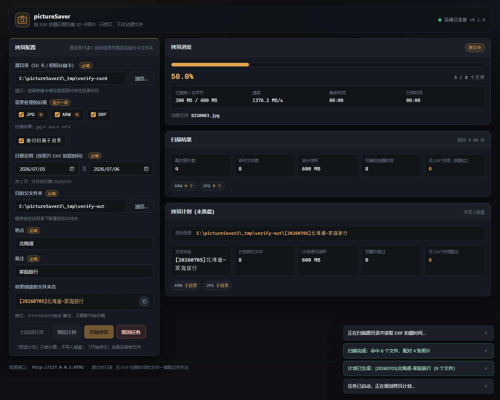
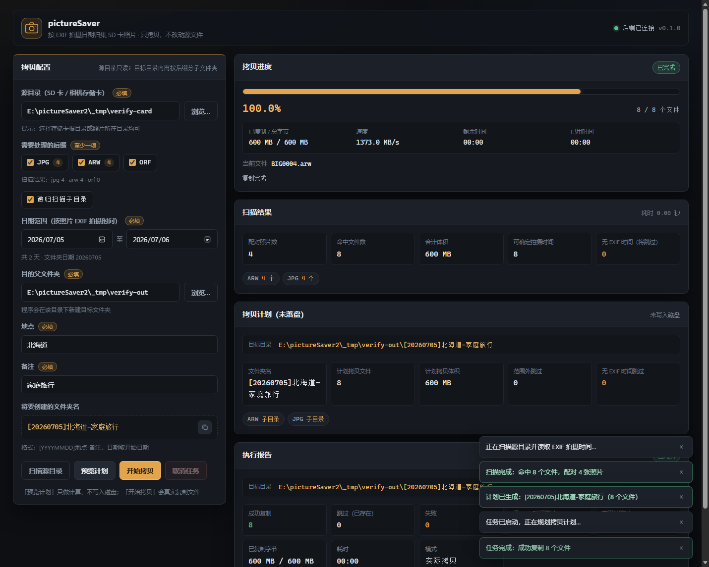

# pictureSaver2 —— SD 卡照片按日期范围拷贝工具

把 SD 卡（相机存储卡）里**指定日期范围内的照片**，按 `jpg + raw` 成对结构拷贝到
`[日期]地点-备注` 目录，并在其内部**按后缀分子文件夹**存放。源文件只读，绝不移动或删除。

- **Web 界面**：选择日期范围 / 源目录 / 后缀 / 目的父目录 / 地点 / 备注，**进度条显示真实进度**（字节级）
- **命令行**：`picsaver scan` / `picsaver copy` / `picsaver web`，带 tqdm 进度条
- **前后端分离**：`core`（纯业务内核）← `api`（FastAPI）/ `cli`，后续可平滑扩展桌面 UI

界面与产出的实际效果（无头 Edge 实跑截图，600 MB 素材）：






---

## 1. 功能

| 需求 | 实现 |
| --- | --- |
| 输入目录（SD 卡） | 递归扫描，自动跳过 `$RECYCLE.BIN`、`System Volume Information`、隐藏目录 |
| jpg + raw 成对 | 同目录同名（忽略大小写与后缀）视为**一张照片**；raw 支持 **arw**（索尼）、**orf**（奥林巴斯），也支持 jpg/jpeg |
| 日期范围 | 拍摄时间来自 EXIF，**范围含首尾两天**；日期范围第一天决定目标目录名的日期 |
| 目标目录 | `父文件夹\[YYYYMMDD]地点-备注`，例如 `E:\照片备份\[20260704]北海道-家庭旅行` |
| 按后缀分文件夹 | 目标目录内 `JPG\`、`ARW\`、`ORF\` … |
| 只拷勾选后缀 | 严格按勾选后缀执行；同名配对只用于**统一时间判定** |
| 无 EXIF 时间 | **跳过**，并在报告 / 界面中逐条列出（不猜测、不静默丢弃） |
| 进度条 | 来自 core 的真实事件：已处理/总文件数、已复制/总字节、当前文件、速度、ETA、已用时间 |
| 安全 | 只复制；临时文件 + 改名防止半截文件；同名同大小视为已存在而跳过；重名自动加 `_1` |
| 报告 | 成功 / 已存在跳过 / 失败明细 / 无时间跳过 / 日期范围外 / 重名改名 / 字节数 / 耗时 |

## 2. 环境与安装

- Python **3.10+**（本机验证版本 3.10.11），Windows
- 依赖（版本为本机已验证组合）：ExifRead、Pillow、fastapi、uvicorn、sse-starlette、pydantic 1.x、typer、click、tqdm；测试用 pytest

```powershell
# 中国大陆：必须使用清华镜像
python -m pip install -r requirements.txt -i https://pypi.tuna.tsinghua.edu.cn/simple
```

> 仓库根目录的 `pip.conf` 是项目级镜像配置示例。
> 本项目**不需要安装**即可运行（`run_web.ps1` 会自动把 `src` 加入 `PYTHONPATH`）；
> 也可以 `python -m pip install -e . -i https://pypi.tuna.tsinghua.edu.cn/simple` 安装成 `picsaver` 命令。

## 3. 使用：Web 界面（推荐）

```powershell
.\run_web.ps1            # 默认 http://127.0.0.1:8765/
.\run_web.ps1 9000       # 指定端口
```

浏览器打开后：

1. **源目录**：手动输入，或点【浏览…】逐级选择（支持盘符列表）
2. **需要处理的后缀**：勾选 jpg / arw / orf（扫描后每项旁显示实际命中数量）
3. **日期范围**：开始 / 结束日期（开始日期即目标文件夹名中的日期）
4. **目的父文件夹**：程序会在其下新建 `[YYYYMMDD]地点-备注`
5. **地点 / 备注**：必填，会写进目录名；非法字符会即时提示
6. 先【预览计划】核对将创建的目标目录与文件数，再【开始拷贝】
7. 进度条实时显示百分比、文件数、字节数、当前文件、速度与剩余时间；可随时【取消任务】

三种操作的关系：`扫描源目录` 只统计；`预览计划` 只计算不写盘；`开始拷贝` 才真正复制文件。

## 4. 使用：命令行

```powershell
# 只扫描统计
python -m picsaver scan -s E:\DCIM -x jpg,arw,orf

# 预览（不落盘）
python -m picsaver copy -s E:\DCIM --date-from 2026-07-04 --date-to 2026-07-06 `
    -t "E:\照片备份" -p 北海道 -n 家庭旅行 -x jpg,arw,orf --dry-run

# 真实拷贝（-p / -n 不传时会交互式询问）
python -m picsaver copy -s E:\DCIM --date-from 2026-07-04 --date-to 2026-07-06 `
    -t "E:\照片备份" -p 北海道 -n 家庭旅行 -x jpg,arw

# 启动 Web 界面
python -m picsaver web --host 127.0.0.1 --port 8765
```

未安装包时请先设置 `$env:PYTHONPATH='src'`，或使用 `run_web.ps1`。

## 5. HTTP 接口（前后端分离的契约）

| 方法 | 路径 | 说明 |
| --- | --- | --- |
| GET | `/` | 前端页面（静态资源在 `/static`） |
| GET | `/api/health` | 健康检查 |
| GET | `/api/defaults` | 界面默认值（默认后缀、今天） |
| GET | `/api/browse?path=` | 目录浏览（省略 path 列出盘符） |
| POST | `/api/scan` | 扫描统计：`{source_dir, suffixes, recursive}` |
| POST | `/api/preview` | 生成计划，不落盘 |
| POST | `/api/jobs` | 创建后台任务：`{config:{...}, dry_run}` |
| GET | `/api/jobs/{id}` | 任务状态 / 进度 / 报告（轮询） |
| GET | `/api/jobs/{id}/events` | **SSE 实时进度**（断线时前端自动降级为轮询） |
| POST | `/api/jobs/{id}/cancel` | 取消任务 |

`config` 字段：`source_dir, suffixes[], date_from, date_to, target_parent, place, note, recursive`。

## 6. 架构

```
浏览器(前端)  --HTTP/SSE-->  api (FastAPI)  --+
                                              +--> core (纯内核，无界面依赖)
CLI (typer)  ---------------------------------+
（未来的桌面 UI）-----------------------------+
```

```
src/picsaver/
├─ core/            # 纯业务内核：不 import 任何 Web / CLI 框架
│  ├─ models.py     #   数据模型与参数校验（CopyConfig / ScanResult / CopyPlan / CopyReport）
│  ├─ exif_time.py  #   拍摄时间：ExifRead -> Pillow -> 内置 TIFF/EXIF 解析
│  ├─ scanner.py    #   扫描、后缀过滤、jpg/raw 配对、无时间文件清单
│  ├─ planner.py    #   日期范围筛选、[YYYYMMDD]地点-备注、后缀子目录、防重名
│  ├─ copier.py     #   分块复制 + 临时文件改名 + 进度事件 + 取消
│  ├─ metrics.py    #   速度 / ETA 估算
│  ├─ events.py     #   进度事件模型
│  └─ service.py    #   门面：scan / preview / run
├─ api/             # FastAPI 后端：参数校验 + 任务编排 + SSE
├─ cli/             # 命令行：scan / copy / web（tqdm 进度条）
└─ web/             # 原生 HTML/CSS/JS 前端（无构建、无 CDN，离线可用）
```

## 7. 测试与验证

```powershell
$env:PYTHONIOENCODING='utf-8'
python -m pytest -q          # 56 项单元/接口/端到端测试
```

测试素材全部为**合成文件**（`tests/fixtures.py` 生成带真实 EXIF 结构的 JPG 与 TIFF 系 ARW/ORF），
不依赖任何真实照片。

已完成的实机验证：

1. `pytest` **57 项全绿**（core 扫描/计划/复制、API 全部端点、端到端流程，以及用真实 uvicorn + SSE 的进度流测试）
2. 真实 `uvicorn` 服务 + 136 个文件的模拟存储卡：扫描 → 预览 → 任务 → **SSE 收到 124 条真实进度事件** → 落盘结构核对，33 项检查全过
3. **无头 Edge 真实浏览器**（`scripts/verify_browser.py`）：填写表单 → 扫描 → 预览 → 拷贝 600 MB，进度 0% → 50% → 100%，速度 1437 MB/s，报告 8/8 成功，产物字节与源完全一致，全程无 JS 错误
4. CLI 三种模式（scan / dry-run / 真实拷贝）实跑通过

### 复现浏览器验证

```powershell
# 1) 启动后端
.\run_web.ps1 8791

# 2) 启动无头 Edge（另开一个终端）
& 'C:\Program Files (x86)\Microsoft\Edge\Application\msedge.exe' `
  --headless=new --disable-gpu --no-first-run --remote-debugging-port=9222 `
  --user-data-dir="$env:TEMP\picsaver-edge" --window-size=1460,1240 http://127.0.0.1:8791/

# 3) 跑验证（会自动生成 600 MB 演示素材、交互、对比磁盘产物并截图）
$env:PYTHONIOENCODING='utf-8'
python scripts\verify_browser.py --base-url http://127.0.0.1:8791
```

## 8. 常见问题

- **无 EXIF 时间的照片怎么办？** 会被跳过并列出。想一并归档时，可先用相机/软件写入拍摄时间，或单独手动处理这些文件。
- **同名文件来自不同子目录？** 目标内自动加 `_1`、`_2`，并在报告中记为"重名改名"。
- **能重复运行吗？** 可以。已存在且大小相同的文件会记为"已存在跳过"，不会重复写入。
- **会修改 SD 卡吗？** 不会。全程只读源目录，只做复制。
- **速度显示 `—`？** 复制刚开始不足 0.2 秒时无法估算速度与 ETA，稍后即会出现。
- **目标父文件夹不能放在源目录里？** 会被拒绝，避免把刚拷贝出来的文件再次当成源文件。

---

架构与协作约定见 [Agent.md](Agent.md)（每次会话必须载入的项目固定约定）。
