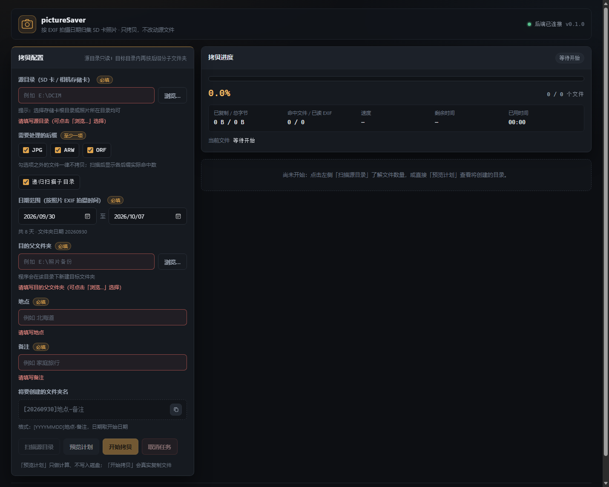
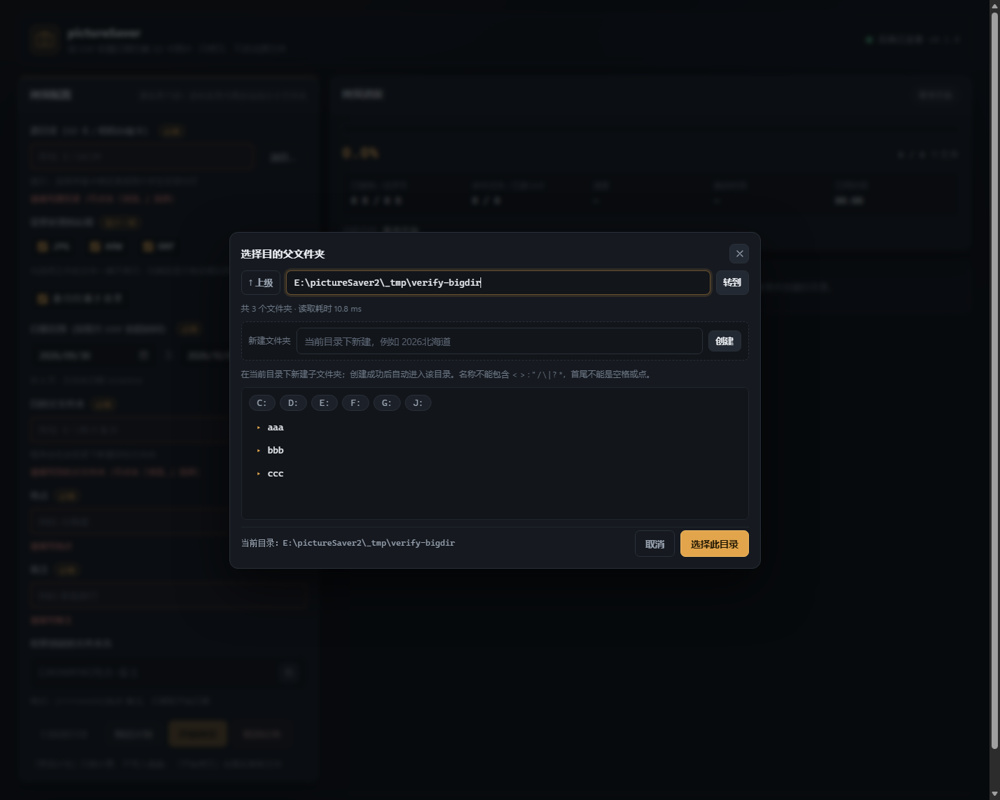
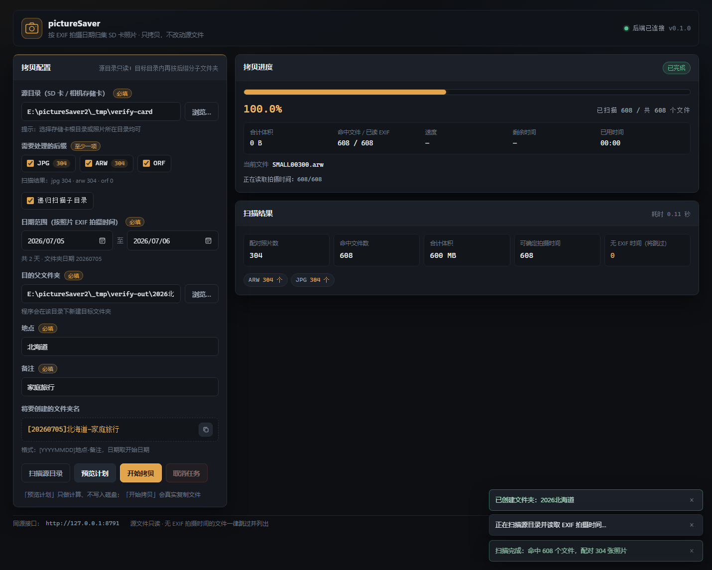
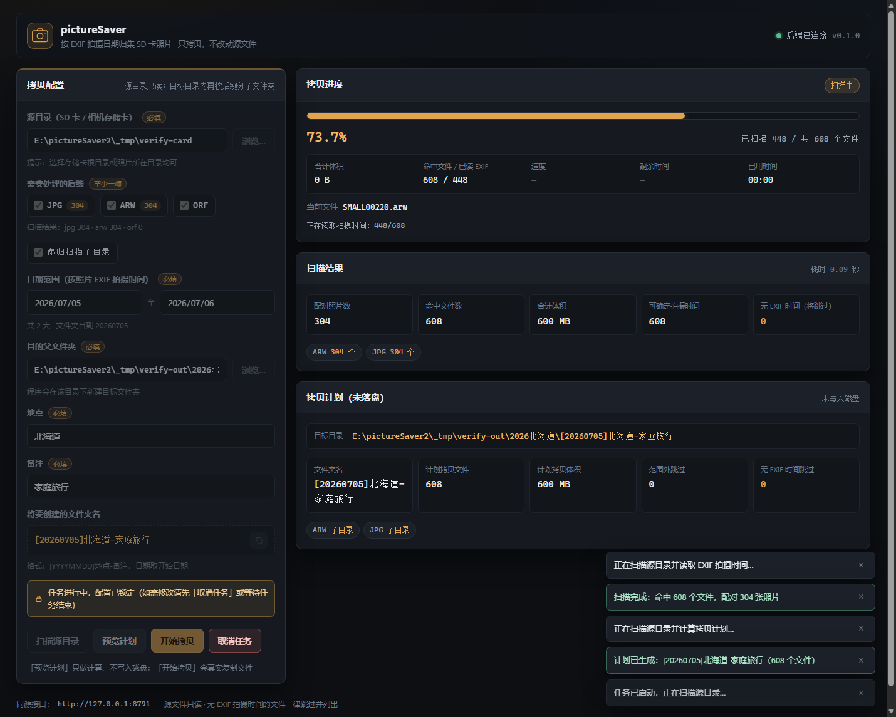
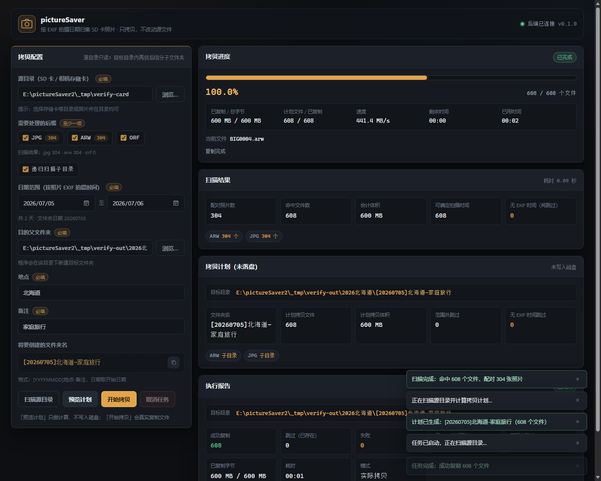

# pictureSaver2 —— SD 卡照片按日期范围拷贝工具

把 SD 卡（相机存储卡）里**指定日期范围内的照片**，按 `jpg + raw` 成对结构拷贝到
`[日期]地点-备注` 目录，并在其内部**按后缀分子文件夹**存放。源文件只读，绝不移动或删除。

- **Web 界面**：选择日期范围 / 源目录 / 后缀 / 目的父目录 / 地点 / 备注，**进度条显示真实进度**（字节级）
- **命令行**：`picsaver scan` / `picsaver copy` / `picsaver web`，带 tqdm 进度条
- **前后端分离**：`core`（纯业务内核）← `api`（FastAPI）/ `cli`，后续可平滑扩展桌面 UI

界面与产出的实际效果（无头 Edge 真实浏览器实跑截图，608 个文件 / 600 MB 素材）：











---

## 1. 功能

| 需求 | 实现 |
| --- | --- |
| 输入目录（SD 卡） | 递归扫描，自动跳过 `$RECYCLE.BIN`、`System Volume Information`、隐藏目录 |
| jpg + raw 成对 | 同目录同名（忽略大小写与后缀）视为**一张照片**；raw 支持 **arw**（索尼）、**orf**（奥林巴斯），也支持 jpg/jpeg |
| 日期范围 | 拍摄时间来自 EXIF，**范围含首尾两天**；日期范围第一天决定目标目录名的日期 |
| 目标目录 | `父文件夹\[YYYYMMDD]地点-备注`，例如 `E:\照片备份\[20260704]北海道-家庭旅行` |
| 按后缀分文件夹 | 目标目录内 `JPG\`、`ARW\`、`ORF\` … |
| 只拷勾选后缀 | 严格按勾选后缀执行；同名配对只用于**统一时间判定** |
| 无 EXIF 时间 | **跳过**，并在报告 / 界面中逐条列出（不猜测、不静默丢弃） |
| 进度条 | 来自 core 的真实事件：**扫描/预览**显示"已扫描 X / 共 Y 个文件"，**复制**显示字节进度、当前文件、速度、ETA、已用时间 |
| 目录浏览 | 浏览弹窗**只列文件夹**、不对普通文件做 stat：2 万个文件的目录实测从 ~1435 ms 降到 ~15 ms（`scripts/bench_browse.py` 可复现），超出 2000 个子目录时提示"仅显示前 2000 个" |
| 新建文件夹 | 浏览弹窗内可直接新建文件夹（`POST /api/mkdir`），带空名/非法字符/重名/Windows 保留名校验 |
| 任务期锁定 | 扫描 / 预览 / 拷贝进行中，配置区整体锁定（输入框、浏览按钮、后缀、日期、地点、备注都不可改），只保留「取消任务」 |
| 安全 | 只复制；临时文件 + 改名防止半截文件；同名同大小视为已存在而跳过；重名自动加 `_1` |
| 报告 | 成功 / 已存在跳过 / 失败明细 / 无时间跳过 / 日期范围外 / 重名改名 / 字节数 / 耗时 |

## 2. 环境与安装

- Python **3.10+**（本机验证版本 3.10.11），Windows
- 依赖（版本为本机已验证组合）：ExifRead、Pillow、fastapi、uvicorn、sse-starlette、pydantic 1.x、typer、click、tqdm；测试用 pytest

```powershell
# 中国大陆：必须使用清华镜像
python -m pip install -r requirements.txt -i https://pypi.tuna.tsinghua.edu.cn/simple
```

> 仓库根目录的 `pip.conf` 是项目级镜像配置示例。
> 本项目**不需要安装**即可运行（`run_web.cmd` / `run_web.ps1` 会自动把 `src` 加入 `PYTHONPATH`）；
> 也可以 `python -m pip install -e . -i https://pypi.tuna.tsinghua.edu.cn/simple` 安装成 `picsaver` 命令。

## 3. 使用：Web 界面（推荐）

```powershell
.\run_web.cmd            # 推荐：默认 http://127.0.0.1:8765/（批处理，不受 PowerShell 执行策略影响）
.\run_web.cmd 9000       # 指定端口

# 也可以用 PowerShell 脚本（若被执行策略拦截，就加 -ExecutionPolicy Bypass）
powershell -NoProfile -ExecutionPolicy Bypass -File .\run_web.ps1 8765
```

浏览器打开后：

1. **源目录**：手动输入，或点【浏览…】逐级选择（只列文件夹，大目录也是秒开；在弹窗里可以直接【新建文件夹】）
2. **需要处理的后缀**：勾选 jpg / arw / orf（扫描后每项旁显示实际命中数量）
3. **日期范围**：开始 / 结束日期（开始日期即目标文件夹名中的日期）
4. **目的父文件夹**：程序会在其下新建 `[YYYYMMDD]地点-备注`
5. **地点 / 备注**：必填，会写进目录名；非法字符会即时提示
6. 先【预览计划】核对将创建的目标目录与文件数，再【开始拷贝】
7. 进度条实时显示进度：扫描/预览阶段是**已扫描 X / 共 Y 个文件**，复制阶段是百分比、字节数、当前文件、速度与剩余时间；可随时【取消任务】

三种操作的关系：`扫描源目录` 只统计；`预览计划` 只计算不写盘；`开始拷贝` 才真正复制文件。
**三种操作运行期间，左侧配置区会整体锁定**，结束后自动解锁，避免任务中途改参数导致结果与预期不符。

## 4. 使用：命令行

```powershell
# 只扫描统计
python -m picsaver scan -s E:\DCIM -x jpg,arw,orf

# 预览（不落盘）
python -m picsaver copy -s E:\DCIM --date-from 2026-07-04 --date-to 2026-07-06 `
    -t "E:\照片备份" -p 北海道 -n 家庭旅行 -x jpg,arw,orf --dry-run

# 真实拷贝（-p / -n 不传时会交互式询问）
python -m picsaver copy -s E:\DCIM --date-from 2026-07-04 --date-to 2026-07-06 `
    -t "E:\照片备份" -p 北海道 -n 家庭旅行 -x jpg,arw

# 启动 Web 界面
python -m picsaver web --host 127.0.0.1 --port 8765
```

未安装包时请先设置 `$env:PYTHONPATH='src'`，或使用 `run_web.ps1`。

## 5. HTTP 接口（前后端分离的契约）

| 方法 | 路径 | 说明 |
| --- | --- | --- |
| GET | `/` | 前端页面（静态资源在 `/static`） |
| GET | `/api/health` | 健康检查 |
| GET | `/api/defaults` | 界面默认值（默认后缀、今天） |
| GET | `/api/browse?path=` | 目录浏览：**只列文件夹**，返回 `path/parent/dirs/truncated/total_dirs/elapsed_ms/error`（省略 path 列盘符） |
| POST | `/api/mkdir` | 新建文件夹：`{parent, name}` → `{path, name, created}` |
| POST | `/api/scan` | 同步扫描统计（脚本用；界面走任务模式以便显示进度） |
| POST | `/api/preview` | 同步生成计划（脚本用） |
| POST | `/api/jobs` | 创建后台任务：`{config:{...}, mode:"scan"\|"preview"\|"copy", dry_run}` |
| GET | `/api/jobs/{id}` | 任务状态 / 进度 / 报告（轮询） |
| GET | `/api/jobs/{id}/events` | **SSE 实时进度**（断线时前端自动降级为轮询） |
| POST | `/api/jobs/{id}/cancel` | 取消任务（三种模式都支持） |

`config` 字段：`source_dir, suffixes[], date_from, date_to, target_parent, place, note, recursive`。
其中 `mode="scan"` 只要求 `source_dir` 与 `suffixes`（日期/地点/备注/目标目录可以是空的），
`preview` / `copy` 则要求字段齐全，否则返回 400 与中文提示。
`mode` 省略时按 `dry_run ? "preview" : "copy"` 处理（兼容旧调用）。
`/api/mkdir` 的所有失败情况（名称为空、含非法字符、首尾空格或点、重名、Windows 保留名、父目录不存在）
统一返回 **400 + 中文字符串 `detail`**，便于界面直接展示。

进度对象（SSE 事件与轮询同构）：

```json
{"phase":"scanning","message":"正在读取拍摄时间：120/500",
 "total_files":500,"done_files":120,"scanned_files":120,"scan_total_files":500,
 "total_bytes":0,"done_bytes":0,"current_file":"E:\\DCIM\\DSC0001.ARW",
 "percent":24.0,"speed_bps":0.0,"eta_seconds":null,"elapsed_seconds":3.1}
```

- `phase`：`counting` → `scanning` → `planning` → `copying` → `finished` / `canceled` / `failed`
- 扫描阶段 `percent = scanned_files / scan_total_files`；复制阶段 `percent` 按字节计算
- 报告按模式区分：`scan` → `{mode, canceled, scan}`；`preview` → `{mode, canceled, plan, scan}`；`copy` → CopyReport 全部字段 + `mode`

## 6. 架构

```
浏览器(前端)  --HTTP/SSE-->  api (FastAPI)  --+
                                              +--> core (纯内核，无界面依赖)
CLI (typer)  ---------------------------------+
（未来的桌面 UI）-----------------------------+
```

```
src/picsaver/
├─ core/            # 纯业务内核：不 import 任何 Web / CLI 框架
│  ├─ models.py     #   数据模型与参数校验（CopyConfig / ScanResult / CopyPlan / CopyReport）
│  ├─ exif_time.py  #   拍摄时间：ExifRead -> Pillow -> 内置 TIFF/EXIF 解析
│  ├─ scanner.py    #   扫描、后缀过滤、jpg/raw 配对、无时间文件清单
│  ├─ planner.py    #   日期范围筛选、[YYYYMMDD]地点-备注、后缀子目录、防重名
│  ├─ copier.py     #   分块复制 + 临时文件改名 + 进度事件 + 取消
│  ├─ metrics.py    #   速度 / ETA 估算
│  ├─ events.py     #   进度事件模型
│  └─ service.py    #   门面：scan / preview / run
├─ api/             # FastAPI 后端：参数校验 + 任务编排 + SSE
├─ cli/             # 命令行：scan / copy / web（tqdm 进度条）
└─ web/             # 原生 HTML/CSS/JS 前端（无构建、无 CDN，离线可用）
```

## 7. 测试与验证

```powershell
$env:PYTHONIOENCODING='utf-8'
python -m pytest -q          # 56 项单元/接口/端到端测试
```

测试素材全部为**合成文件**（`tests/fixtures.py` 生成带真实 EXIF 结构的 JPG 与 TIFF 系 ARW/ORF），
不依赖任何真实照片。

已完成的实机验证：

1. `pytest` **84 项全绿**（core 扫描/计划/复制、任务模式与扫描进度、API 全部端点、目录浏览与新建文件夹、端到端流程，以及真实 uvicorn + SSE 进度流）
2. 真实 `uvicorn` 服务 + 90 个文件的模拟存储卡：**26 项检查全过**，含浏览 20000 文件目录耗时 **11 ms**、扫描任务进度真实推进、预览任务未落盘
3. **无头 Edge 真实浏览器**（`scripts/verify_browser.py`）：**35 项检查全过** ——
   两万文件目录浏览 10.8 ms 且只列出 3 个文件夹、弹窗内新建文件夹并自动进入（重名有提示）、
   扫描/预览/拷贝三个阶段都有真实进度（扫描阶段显示「已扫描 544 / 共 608 个文件」）、
   任务运行中配置区锁定且只留「取消任务」、结束后自动解锁，608 个文件全部复制成功、字节与源一致、全程无 JS 错误
4. 目录浏览性能基线可复现：`python scripts\bench_browse.py`（20000 文件：旧实现 ~1435 ms → 新实现 ~15 ms）
5. CLI 四种用法（scan / dry-run / 真实拷贝 / web）实跑通过，扫描与复制都有 tqdm 进度条

### 复现浏览器验证

```powershell
# 1) 启动后端
.\run_web.cmd 8791

# 2) 启动无头 Edge（另开一个终端）
& 'C:\Program Files (x86)\Microsoft\Edge\Application\msedge.exe' `
  --headless=new --disable-gpu --no-first-run --remote-debugging-port=9222 `
  --user-data-dir="$env:TEMP\picsaver-edge" --window-size=1460,1240 http://127.0.0.1:8791/

# 3) 跑验证（会自动生成 600 MB 演示素材、交互、对比磁盘产物并截图）
$env:PYTHONIOENCODING='utf-8'
python scripts\verify_browser.py --base-url http://127.0.0.1:8791
```

## 8. 常见问题

- **无 EXIF 时间的照片怎么办？** 会被跳过并列出。想一并归档时，可先用相机/软件写入拍摄时间，或单独手动处理这些文件。
- **同名文件来自不同子目录？** 目标内自动加 `_1`、`_2`，并在报告中记为"重名改名"。
- **能重复运行吗？** 可以。已存在且大小相同的文件会记为"已存在跳过"，不会重复写入。
- **会修改 SD 卡吗？** 不会。全程只读源目录，只做复制。
- **速度显示 `—`？** 复制刚开始不足 0.2 秒时无法估算速度与 ETA，稍后即会出现。
- **点【浏览…】时看着卡？** 浏览接口只列文件夹、不读文件属性；若某个目录子文件夹超过 2000 个，会提示"仅显示前 2000 个"（可用上方路径框直接输入深层路径继续进入）。
- **任务运行时改不了参数？** 这是有意的：扫描/预览/拷贝进行中配置区会锁定，点【取消任务】或在任务结束后即可继续编辑。
- **`.\run_web.ps1` 报"未对文件进行数字签名"？** 这是 PowerShell 执行策略的限制，用 `.\run_web.cmd`，或执行
  `powershell -NoProfile -ExecutionPolicy Bypass -File .\run_web.ps1`。
- **目标父文件夹不能放在源目录里？** 会被拒绝，避免把刚拷贝出来的文件再次当成源文件。

---

架构与协作约定见 [Agent.md](Agent.md)（每次会话必须载入的项目固定约定）。
